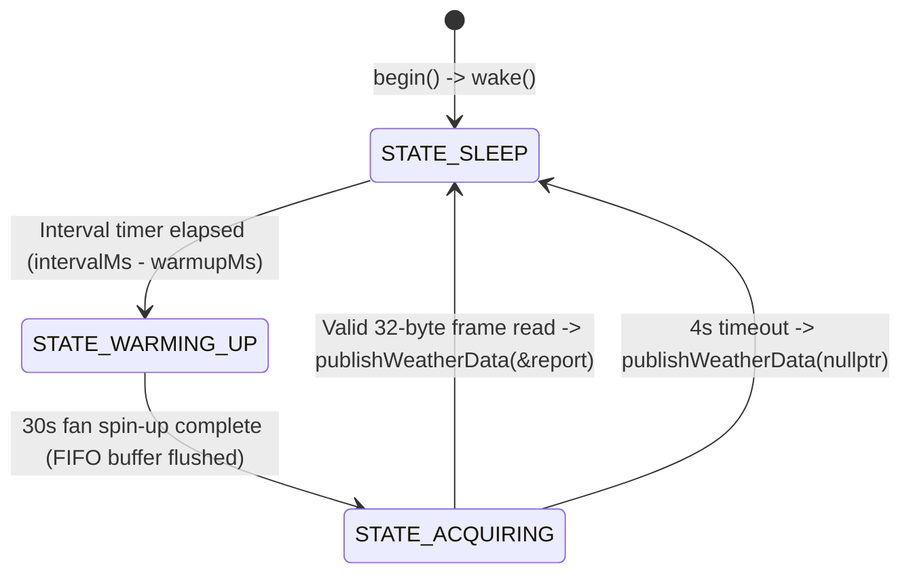

# ESP8266 IoT Weather Station Firmware (`device/`)

This directory contains the PlatformIO embedded C++ firmware for the physical ESP8266 Weather Station. It reads ambient temperature, relative humidity, sea-level barometric pressure, and atmospheric particulate matter (PM1.0, PM2.5, PM10), then publishes JSON telemetry over Wi-Fi to either a local Mosquitto MQTT broker or **Azure IoT Hub**.

---

## 1. Hardware Bill of Materials (BOM)

* **Microcontroller**: ESP8266 development board (`espmxdevkit` / NodeMCU 1.0)
* **Temperature & Humidity Sensor**: DHT22 (AM2302)
* **Barometric Pressure Sensor**: Bosch BMP180 (I2C)
* **Particulate Matter Air Quality Sensor**: Plantower PMS5003 (UART laser scattering sensor)

---

## 2. GPIO Pinout & Wiring Guide

The default pin assignments are configured in `include/secrets.h` (from `include/secrets.h.template`) and `src/main.cpp`:

| Component | Sensor Pin | ESP8266 GPIO | NodeMCU Label | Notes |
| :--- | :--- | :--- | :--- | :--- |
| **DHT22** | `DATA` | `GPIO 14` | `D5` | Requires 3.3V VCC and pull-up resistor if using bare sensor. |
| **BMP180 (I2C)** | `SDA` | `GPIO 4` | `D2` | 3.3V I2C Data line. |
| **BMP180 (I2C)** | `SCL` | `GPIO 5` | `D1` | 3.3V I2C Clock line. |
| **PMS5003 (UART)** | `TXD` (Pin 5) | `GPIO 12` | `D6` | Connects to ESP8266 SoftwareSerial RX (`PIN_PMS_RX`). Uses 3.3V logic level. |
| **PMS5003 (UART)** | `RXD` (Pin 4) | `GPIO 13` | `D7` | Connects to ESP8266 SoftwareSerial TX (`PIN_PMS_TX`). Required for software wake/sleep commands. |
| **PMS5003 (Control)** | `SET` (Pin 3) | `GPIO 15` (or `-1`) | `D8` | Optional hardware sleep/wake pin (`PIN_PMS_SET`). Set `PIN_PMS_SET -1` in `secrets.h` if left floating/3.3V to rely on UART software sleep/wake. |
| **PMS5003 (Power)** | `VCC` (Pin 1) | `5V / VIN` | `VIN / VU` | **Must be connected to 5V** to spin the internal fan and power the laser; Serial I/O remains 3.3V safe. |

---

## 3. Configuration (`include/secrets.h`)

The `include/secrets.h` file is git-ignored (`device/.gitignore`) to prevent committing credentials. Before building or flashing, create your local `secrets.h` from the template:

```bash
cd device
cp include/secrets.h.template include/secrets.h
```

### Key Settings in `include/secrets.h`

* **Location & Calibration**:
  * `ALTITUDE_METERS`: Your local elevation in meters (used by `pressure.sealevel(P, ALTITUDE_METERS)` to normalize absolute BMP180 pressure readings to sea-level hPa/mb).
  * `LAT` / `LONG`: Station latitude and longitude included in the telemetry payload.
  * `DATA_COLLECTION_INTERVAL`: Milliseconds between sensor publications (e.g., `60000` for 1 minute or `300000` for 5 minutes). Must be greater than `PMS_WARMUP_MS` (`30000` ms).

* **Option A: Local Mosquitto Broker (Port `1883`)**:
  ```cpp
  #define MQTT_SERVER "192.168.1.X" // Host IP running Aspire or Docker Compose
  #define MQTT_PORT 1883
  #define MQTT_CLIENT_ID "WeatherStationESP8266"
  #define MQTT_USER "dev_user"
  #define MQTT_PASSWORD "dev_password"
  #define MQTT_TELEMETRY_TOPIC "weather/telemetry"
  ```

* **Option B: Azure IoT Hub over TLS (Port `8883`)**:
  ```cpp
  #define MQTT_SERVER "<your-iothub-name>.azure-devices.net"
  #define MQTT_PORT 8883
  #define MQTT_CLIENT_ID "<your-device-id>"
  #define MQTT_USER "<your-iothub-name>.azure-devices.net/<your-device-id>/?api-version=2021-04-12"
  #define MQTT_PASSWORD "SharedAccessSignature sr=<your-iothub-name>.azure-devices.net%2Fdevices%2F<your-device-id>&sig=...&se=..."
  #define MQTT_TELEMETRY_TOPIC "devices/<your-device-id>/messages/events/"
  ```
  You can generate the `SharedAccessSignature` token using the Azure CLI:
  ```bash
  az iot hub generate-sas-token \
    --hub-name "<your-iothub-name>" \
    --device-id "<your-device-id>" \
    --duration 31536000 \
    --query sas -o tsv
  ```

---

## 4. Firmware Architecture & Sensor Lifecycle

### Wi-Fi Captive Portal (`WiFiManager`)
On startup, the ESP8266 calls `wifiManager.autoConnect("WEATHER-STATION")`. If no saved Wi-Fi credentials are found (or connection fails), the device broadcasts an access point named **`WEATHER-STATION`**. Connect to it with a phone or laptop to configure Wi-Fi credentials via the captive portal, after which it synchronizes UTC time via NTP (`pool.ntp.org`).

### PMS5003 Non-Blocking Interval Sampler (`include/PMSIntervalSampler.h`)
Because the PMS5003 laser and fan have a finite operational lifespan and require 30 seconds of airflow stabilization before readings are accurate, `PMSIntervalSampler` implements a non-blocking state machine called on every `loop()` tick:



1. **`STATE_SLEEP`**: The PMS5003 is placed in low-power sleep mode (fan off) between intervals.
2. **`STATE_WARMING_UP` (30 seconds)**: Wakes the sensor and continuously drains bytes from the ESP8266 `SoftwareSerial` 64-byte FIFO buffer so it does not overflow while the fan spins up. Once 30 seconds elapse, stale bytes are flushed.
3. **`STATE_ACQUIRING` (up to 4 seconds)**: Waits for a fresh, checksum-verified 32-byte frame (`PM1.0`, `PM2.5`, `PM10` atmospheric $\mu\text{g/m}^3$), puts the sensor back to sleep, and triggers `publishWeatherData(&report)`.
4. **Fault Tolerance**:
   * If the PMS5003 times out or is disconnected, the sampler logs diagnostic wiring hints on Serial (`9600` baud), puts the sensor back to sleep, and still publishes temperature, humidity, and pressure with `pm1_0`, `pm2_5`, and `pm10_0` set to `0`.
   * DHT22 reads are retried up to 3 times with a 250ms backoff to mitigate single-wire timing glitches. If DHT22 fails, `20.0°C` is used as a fallback temperature for the BMP180 sea-level pressure calculation.

---

## 5. Building, Flashing & Serial Monitoring

Using the [PlatformIO CLI](https://docs.platformio.org/en/latest/core/index.html) or VS Code PlatformIO extension:

```bash
cd device

# Compile the firmware
pio run

# Build and flash to ESP8266 (/dev/ttyUSB0 configured in platformio.ini)
pio run --target upload

# Open Serial Monitor (9600 baud)
pio device monitor -b 9600
```
