# System Architecture & Data Contracts

This document describes the end-to-end architecture of the **WeatherStation** monorepo, how **.NET Aspire** and **Dapr** abstract local vs. Azure cloud infrastructure, and the exact data contracts between the ESP8266 hardware, Dapr State Store, GraphQL API, and Angular frontend.

---

## 1. End-to-End Topology

```mermaid
flowchart LR
    subgraph Device ["ESP8266 Firmware (/device)"]
        Sensors["DHT22 + BMP180 + PMS5003"] --> MCU["ESP8266 NodeMCU"]
    end

    subgraph Broker ["Telemetry Ingestion"]
        Mosquitto["Local: Eclipse Mosquitto<br/>(MQTT :1883, topic: weather/telemetry)"]
        IoTHub["Cloud: Azure IoT Hub<br/>(MQTTS :8883, EventHub endpoint)"]
    end

    subgraph Processor ["Ingestion Microservice"]
        DaprIn["Dapr Input Binding<br/>(mqtt-telemetry)"]
        TP["WeatherStation.TelemetryProcessor<br/>(POST /mqtt-telemetry)"]
    end

    subgraph Storage ["Persistence Layer"]
        PG[("PostgreSQL<br/>Dapr State Store (statestore)")]
        Blob[("Azure Blob Storage<br/>(telemetry-checkpoints)<br/>Cloud Only")]
    end

    subgraph Backend ["Query Microservice"]
        DaprApi["Dapr Sidecar (api)"]
        API["WeatherStation.Api<br/>(HotChocolate GraphQL /graphql)"]
    end

    subgraph Frontend ["Web Client"]
        Web["WeatherStation.Web<br/>(Angular 22 + Apollo Client)"]
    end

    MCU -->|"Local WiFi"| Mosquitto
    MCU -->|"TLS + SAS Token"| IoTHub
    Mosquitto -->|"bindings.mqtt"| DaprIn
    IoTHub -->|"bindings.azure.eventhubs"| DaprIn
    IoTHub -.->|"EventProcessor Checkpoints"| Blob
    DaprIn --> TP
    TP -->|"SaveStateAsync (Key = ISO-8601 UTC)"| PG
    PG -->|"QueryStateAsync"| DaprApi
    DaprApi --> API
    Web -->|"HTTP POST /graphql"| API
```



---

## 2. Local vs. Production Infrastructure Switching

A core design goal of this repository is keeping the application code in `WeatherStation.TelemetryProcessor` and `WeatherStation.Api` 100% cloud-agnostic. Neither service references Azure SDKs or MQTT client libraries directly; instead, they interact strictly with **Dapr building blocks** (`mqtt-telemetry` input binding and `statestore` state store).

`WeatherStation.AppHost/Program.cs` inspects `builder.ExecutionContext.IsRunMode` to wire the appropriate backing infrastructure automatically:

| Capability | Local Run Mode (`IsRunMode == true` / Docker Compose) | Production Publish Mode (`aspire deploy` to Azure Container Apps) |
| :--- | :--- | :--- |
| **Telemetry Broker** | Containerized Eclipse Mosquitto (`../.devdeploy/mosquitto`) on port `1883`. | External **Azure IoT Hub** using its built-in Event Hubs-compatible endpoint. |
| **Dapr Input Binding (`mqtt-telemetry`)** | `bindings.mqtt` subscribed to `weather/telemetry` (`consumerID: telemetry-processor-consumer`). | `bindings.azure.eventhubs` using consumer group `telemetry-processor-consumer` and an Aspire-provisioned Azure Storage Account (`daprstorage` / `telemetry-checkpoints`) for stream offset checkpointing. |
| **Database & State Store (`statestore`)** | Local PostgreSQL container (`weatherdb` database) with pgAdmin enabled. | PostgreSQL container in ACA configured with secure Bicep secret parameter `postgresPassword`. |
| **Frontend (`app` / `web`)** | Nginx container built from `WeatherStation.Web/Dockerfile` exposed on `http://localhost:4200`. | Azure Container App with external HTTP ingress and runtime `API_URL` injection via `docker-entrypoint.sh`. |

---

## 3. Data Contracts & Unit Transformations

### Stage 1: Device-to-Broker MQTT JSON Payload

The ESP8266 firmware (`device/src/main.cpp`) and the mock simulator (`publish_mock_telemetry.sh`) publish a compact JSON document to the MQTT broker:

```json
{
  "id": "123456",
  "time": 1761949800,
  "sensor_h": 55.4,
  "sensor_t": 23.8,
  "sensor_bp": 1012.35,
  "lat": 37.7749,
  "long": -122.4194,
  "pm1_0": 5,
  "pm2_5": 12,
  "pm10_0": 18
}
```

| Field | Type | Unit / Format | Description & Fallback Behavior |
| :--- | :--- | :--- | :--- |
| `id` | `string` | Chip ID | ESP8266 hardware chip ID (`String(ESP.getChipId())`) or simulator ID. |
| `time` | `long` | Unix Epoch (seconds) | UTC timestamp synchronized via NTP (`pool.ntp.org`). |
| `sensor_h` | `double` | Relative Humidity (`%`) | Read from DHT22. Defaults to `0.0` if sensor read fails after 3 retries. |
| `sensor_t` | `double` | **Celsius (`°C`)** | Read from DHT22. Defaults to `0.0` if sensor read fails after 3 retries. |
| `sensor_bp` | `double` | Millibars / hPa | Sea-level compensated pressure from BMP180 (uses `ALTITUDE_METERS` and `sensor_t`, or `20.0°C` fallback if DHT22 failed). |
| `lat` / `long` | `double` | Decimal Degrees | Configured station coordinates from `secrets.h`. |
| `pm1_0` | `double` | $\mu\text{g/m}^3$ (Atmospheric) | PM1.0 concentration from PMS5003 (`PM_AE_UG_1_0`). `0` if sensor timed out. |
| `pm2_5` | `double` | $\mu\text{g/m}^3$ (Atmospheric) | PM2.5 concentration from PMS5003 (`PM_AE_UG_2_5`). `0` if sensor timed out. |
| `pm10_0` | `double` | $\mu\text{g/m}^3$ (Atmospheric) | PM10 concentration from PMS5003 (`PM_AE_UG_10_0`). `0` if sensor timed out. |

---

### Stage 2: Ingestion & Dapr State Store Persistence

1. **Dapr Binding Trigger**: When a message arrives on the broker, the `telemetry` Dapr sidecar sends an HTTP `POST /mqtt-telemetry` request to `WeatherStation.TelemetryProcessor`.
2. **State Key Format**: `WeatherStation.TelemetryProcessor/Program.cs` converts the payload's Unix epoch `time` to a round-trip ISO-8601 UTC string (`DateTimeOffset.FromUnixTimeSeconds(payload.Time).UtcDateTime.ToString("o")`, e.g., `2026-10-31T22:30:00.0000000Z`).
3. **PostgreSQL Storage**: Dapr stores the JSON document in the `state` table of PostgreSQL under key `telemetry||<ISO-8601-timestamp>` with `contentType: application/json` so that Dapr's State Query API can inspect the JSON fields.

---

### Stage 3: GraphQL API Schema & Unit Conversions

`WeatherStation.Api` exposes a HotChocolate GraphQL endpoint at `/graphql` (`WeatherStation.Api/Query.cs`).

> [!IMPORTANT]
> **Temperature Unit Conversion**: The raw state store payload stores `sensor_t` in **Celsius**, which is returned directly by `listWeatherData`. All higher-level dashboard queries (`weatherReadings`, `latestReadings`, `paginatedReadings`, and `weatherReading`) automatically convert temperature to **Fahrenheit** (`temperatureFahrenheit = (sensor_t * 9 / 5) + 32`) and format `time` as an ISO-8601 UTC `timestamp` string.

#### Available GraphQL Queries

| Query | Arguments | Return Type | Notes |
| :--- | :--- | :--- | :--- |
| `latestReadings` | `count: Int = 10` | `[WeatherReadingItem!]!` | Returns the most recent `count` readings ordered by `time` descending (in °F). |
| `paginatedReadings` | `pageNumber: Int = 1`, `pageSize: Int = 10` | `WeatherReadingPageResult!` | Clamps `pageSize` to `1..50`. Returns `totalCount`, `pageNumber`, `pageSize`, and `items` (in °F). |
| `weatherReadings` | `filter: String`, `sort: String` | `[WeatherReadingItem!]!` | Returns up to 1,000 readings ordered by `time` descending (in °F). *(Note: `filter` and `sort` arguments are currently reserved placeholders).* |
| `weatherReading` | `id: Int!` | `WeatherReadingItem` | Looks up a reading by its 1-based sequential index in the latest 1,000 readings. |
| `listWeatherData` | `limit: Int = 1000` | `WeatherDataResult!` | Returns raw telemetry fields (`sensor_bp`, `sensor_h`, `sensor_t` in **°C**, `time` in Unix seconds, `pm1_0`, `pm2_5`, `pm10_0`). |

#### Example GraphQL Query

```graphql
query GetDashboardData {
  latestReadings(count: 1) {
    id
    deviceId
    timestamp
    temperatureFahrenheit
    humidity
    pressure
    pm1_0
    pm2_5
    pm10_0
  }
  paginatedReadings(pageNumber: 1, pageSize: 10) {
    totalCount
    pageNumber
    pageSize
    items {
      id
      timestamp
      temperatureFahrenheit
      humidity
      pressure
      pm2_5
    }
  }
}
```

#### Query Limitations & State Store Notes
* `Query.cs` uses `daprClient.QueryStateAsync<TelemetryPayloadDto>` with a page limit of up to `1000` records, sorting by `Time` descending in memory.
* If the Dapr state store is unreachable or empty, `LoadTelemetryPayloadsAsync` logs the error and safely returns an empty collection rather than throwing an unhandled GraphQL exception.

---

## 4. Service Port Reference

| Service | Aspire Port (Host -> Target) | Docker Compose Port | Description |
| :--- | :--- | :--- | :--- |
| **WeatherStation.Web** | `4200 -> 80` | `4200 -> 80` | Angular UI served by Nginx |
| **WeatherStation.Api** | `5081 -> 8080` | `5081 -> 8080` | GraphQL API (`/graphql`) and health checks (`/health`, `/alive`) |
| **WeatherStation.TelemetryProcessor** | `5082 -> 5080` | `8080 -> 8080` | Dapr input binding target (`POST /mqtt-telemetry`) |
| **Mosquitto MQTT Broker** | `1883 -> 1883` | `1883 -> 1883` | Local unauthenticated/dev MQTT broker |
| **PostgreSQL** | `5432 -> 5432` | `5432 -> 5432` | Backing database for Dapr `statestore` |
